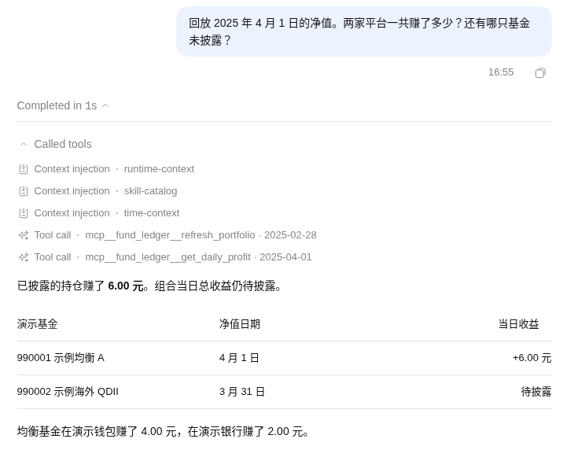
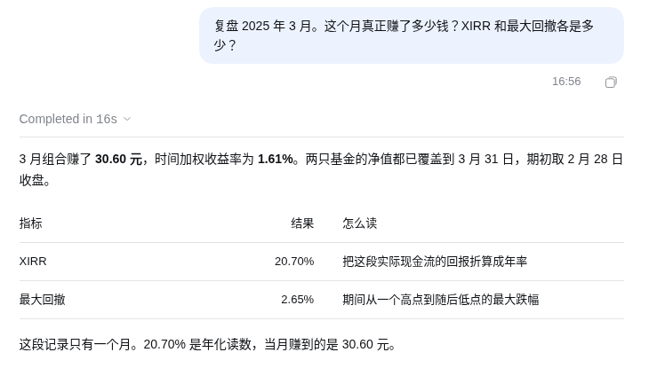
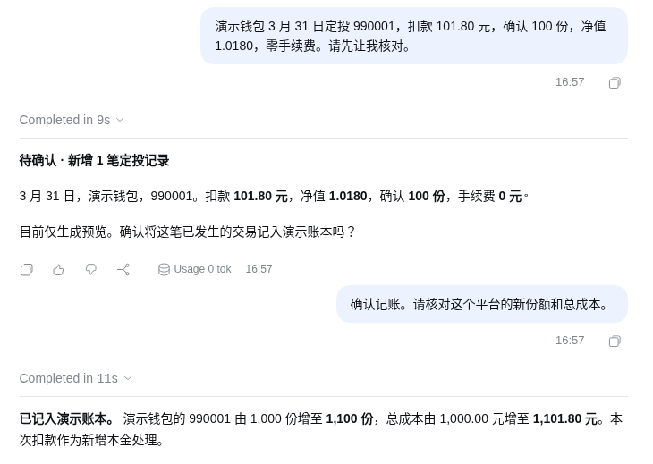
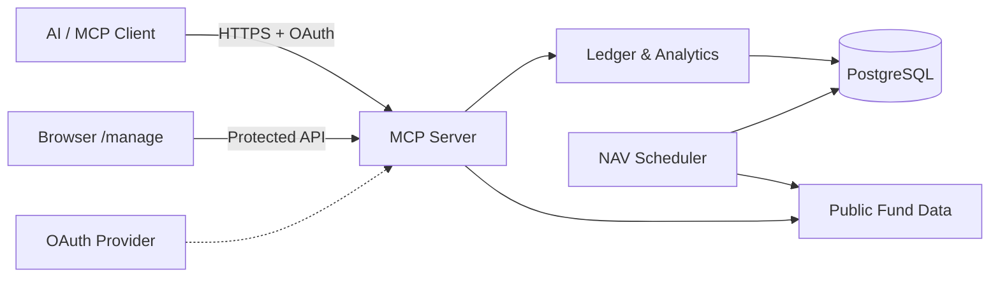

<div align="center">

# 基金账本 · Fund Ledger MCP

**让 AI 成为你的基金记账与投资分析助手。**

面向人民币场外基金的可自托管 MCP 服务 · 持久化账本 · 正式净值 · 资金流调整收益

[](https://modelcontextprotocol.io/)
[](https://nodejs.org/)
[](https://www.postgresql.org/)
[](https://github.com/Shunder/fund-ledger-mcp/actions/workflows/ci.yml)
[](LICENSE)

[本地试用](#3-分钟本地试用) · [接入自己的客户端](docs/CLIENTS.md) · [上云部署](docs/DEPLOY.md) · [记账口径](docs/USAGE.md)

</div>

## 3 分钟本地试用

用 Node.js 22.21+ 打开一个内置虚构账本，直接看持仓、XIRR 和最大回撤。首次安装需要网络；运行演示只用本机内存，无需注册账号、配置数据库或提供模型密钥。

```sh
git clone https://github.com/Shunder/fund-ledger-mcp.git
cd fund-ledger-mcp
npm ci --ignore-scripts
npm run demo
```

你会看到两个平台持有的两只基金。3 月赚了 **30.60 元**，年化 XIRR 为 **20.70%**，最大回撤为 **2.65%**。4 月 1 日只有一只基金披露了净值，已知日收益为 **6.00 元**，组合日收益仍待披露。每次运行都会从虚构流水和回放净值重新计算。

**想直接跟 AI 聊？** 已装 DeepSeek Harness 的访客可在同一目录运行 `dsh web --patch examples/clients/deepseek-demo.yml`。也可运行 `npm run --silent client-config` 生成通用 stdio 配置。打开客户端后问：“分析演示组合 2025 年 3 月的收益。” [DeepSeek Harness、Claude Desktop、VS Code 及远程客户端接入](docs/CLIENTS.md)

## 看一次实际对话

以下截图来自 DeepSeek Harness Web 的本地测试会话。Codex 通过本机测试接口给出工具调用和中文回复，Harness 实际连接本仓库的 stdio 服务。演示账户、日期和净值与上面的命令一致。

**同步净值，辨认未披露的 QDII**



**用最近一个完整月解释年化收益和回撤**



**核对定投，确认后再看新增份额**



## 为什么使用基金账本？

基金账本将公开基金行情与私人投资流水结合，让支持 MCP 的 AI 客户端能够跨会话查询持仓、计算收益和辅助投资复盘。数据由自己的 PostgreSQL 保存，不必每次重新向 AI 提供整份持仓。

| 能力 | 说明 |
| --- | --- |
| 📚 持久化账本 | 多平台持仓、批量导入、交易流水、分红与基金转换 |
| 📈 行情查询 | 基金档案、正式净值、历史净值、盘中估值及重仓股 |
| 📊 投资分析 | 日/月/年收益、已实现与未实现收益、TWR、XIRR、最大回撤 |
| 🔄 净值同步 | 上海时区调度、历史回补、披露延迟与错误状态 |
| 🔐 身份隔离 | OAuth、用户白名单、读写权限、修改预览与确认 |
| 🌐 多端访问 | Streamable HTTP MCP、可信本机 stdio、浏览器管理页 |

> 本项目仅用于记账和分析，不连接银行账户，不执行实际交易，不提供收益保证。

## 使用场景

在已连接的 MCP 客户端中，可以直接用自然语言提问：

- “列出我的基金持仓，显示市值、收益率和净值日期。”
- “同步最新披露净值，列出每日收益和未披露的基金。”
- “记录一笔已确认的申购，金额、份额及手续费如下。”
- “分析最近一个月的资金流调整收益、最大回撤和资产配置。”

批量导入示例（虚构演示数据，不代表任何实际账户）：

```csv
platform,code,day,shares,unitCost
DEMO,000123,2025-01-02,100.00,1.2000
```

录入前核对平台、份额、成本与基准日期；批量修改须预览并确认。

## 架构



## 进阶部署与持久化私人账本

需要 Node.js 22.21+（已测试 Node 24）、PostgreSQL，以及 HTTPS/OAuth 配置。

```bash
git clone https://github.com/Shunder/fund-ledger-mcp.git
cd fund-ledger-mcp
npm ci --ignore-scripts
cp .env.example .env
# 配置自己的数据库、HTTPS origin、OAuth issuer 和用户白名单
node --env-file=.env src/index.js --http
```

HTTP 启动时自动执行数据库迁移。生产环境应通过平台 Secret 注入配置，使用 HTTPS 反向代理或托管平台。不要提交 .env 或真实交易数据。

| 部署方式 | 适合场景 |
| --- | --- |
| [免费额度部署](docs/FREE.md) | 可接受冷启动的个人用户；Railway、Neon 与独立同步 |
| [常驻云服务](docs/DEPLOY.md) | 持续可用、内置调度、OAuth 与 ChatGPT 接入 |
| Docker | 自托管容器环境；仓库提供 Dockerfile |
| stdio | 可信本机客户端；需额外设置 STDIO_SUBJECT |

常用命令：

```bash
npm start       # HTTP 服务
npm run stdio   # 本机 MCP
npm run migrate # 数据库迁移
npm run sync    # 独立净值同步
npm run tools   # 生成工具参数目录
npm test       # 需要专用 TEST_DATABASE_URL 和 OpenSSL
```

## 接入 MCP 客户端

按照[部署指南](docs/DEPLOY.md)完成 Auth0 配置，将自己的 HTTPS 服务地址加上 /mcp 作为 MCP endpoint，使用 OAuth 授权。具体客户端支持的读写能力取决于其套餐、工作区和授权设置。只读客户端可通过同一服务的 /manage 页面录入。

- /health：健康检查
- /mcp：受 OAuth 保护的 Streamable HTTP MCP
- /manage：浏览器管理页面

## MCP 工具索引

| 类别 | 代表工具 |
| --- | --- |
| 基金研究 | search_funds · get_fund_info · get_fund_nav_history |
| 持仓管理 | get_portfolio · import_holdings · update_holding |
| 交易流水 | record_transaction · get_transactions |
| 收益分析 | get_daily_profit · get_portfolio_summary · get_xirr · get_max_drawdown |
| 资产配置 | get_asset_allocation |
| 数据维护 | refresh_portfolio · get_data_status · export_portfolio |

完整接口及参数见[工具索引](docs/TOOLS.md)和[JSON Schema](docs/tools.json)。

## 数据准确性与隐私

- 正式收益使用已披露单位净值，盘中估值单独展示。
- QDII、休市和数据源异常可能造成净值延迟；缺失值不会被当作零。
- 期初持仓以前的交易未知，历史绩效需要可靠的现金流记录。
- 真实账本、密钥和数据库备份不得提交到 Git；公开示例应仅使用虚构数据。
- 应用层按 OAuth 身份隔离账本，托管数据库管理员仍可访问数据。
- 目前支持人民币普通单位净值场外基金，不支持外币份额、货币基金万份收益等特殊模型。

## 文档

| 文档 | 内容 |
| --- | --- |
| [使用说明](docs/USAGE.md) | 交易口径、收益算法、自然语言示例及限制 |
| [部署指南](docs/DEPLOY.md) | 云端配置、OAuth、备份与恢复 |
| [免费部署](docs/FREE.md) | 免费额度方案与取舍 |
| [设计说明](docs/DESIGN.md) | 数据模型、认证及安全边界 |
| [测试报告](docs/TESTING.md) | 已执行的测试与待验收项 |
| [上游说明](docs/UPSTREAM.md) | 上游归属及数据来源 |

## 贡献与许可

欢迎提交 Issue 和 Pull Request。请使用虚构测试数据，不要在 Issue、日志或截图中附上访问令牌、数据库连接串、真实持仓或其他个人信息。安全问题请勿在公开 Issue 中披露细节。

行情适配器基于 [smallke/cn-funds-mcp](https://github.com/smallke/cn-funds-mcp)，基线提交为 `bb44fbc653bb068f0cacd588f19aed0249bffc3d`。上游 package.json 声明 MIT，未附独立许可证文件；本项目保留作者与原说明，并补充 MIT 全文。行情数据权利和使用条件见[上游声明](docs/UPSTREAM.md)。

本项目采用 [MIT License](LICENSE)。

